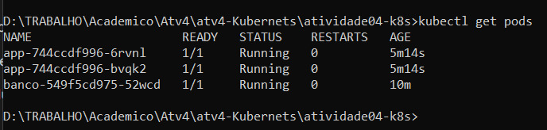
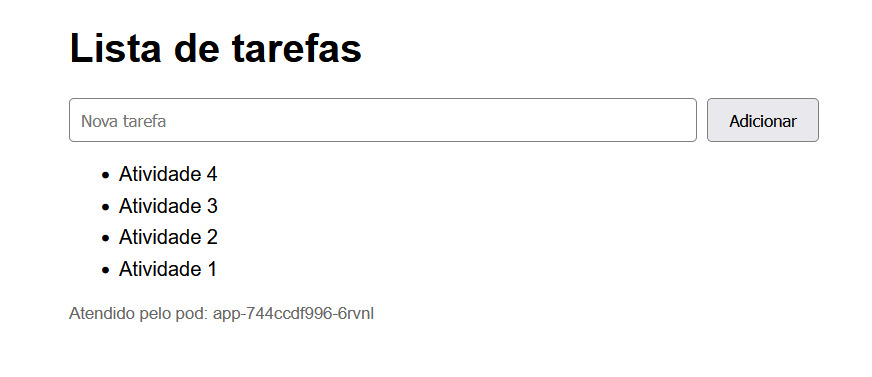
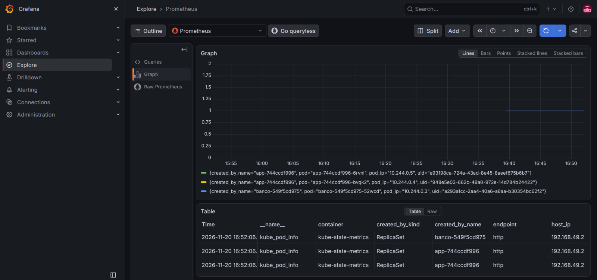
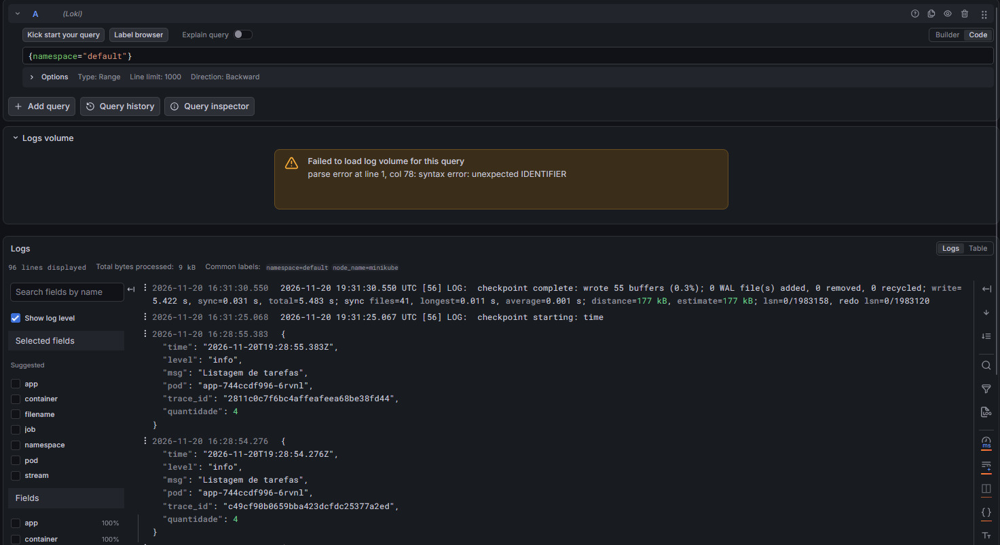
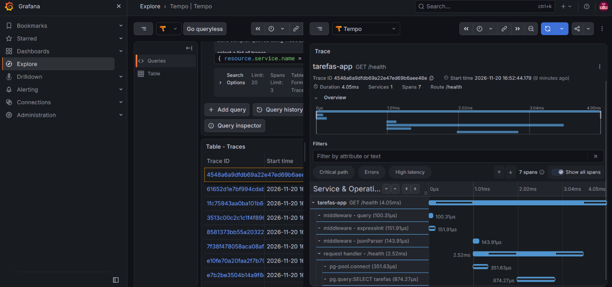

# Atividade 04 - Plataforma, Monitoramento e Observabilidade

**Grupo:** Caio Abreu, Cassiano Abreu, Enzo Aquino, Gabriel Naoki e Wyllian Mariano

## Descrição da aplicação

Aplicação web simples de lista de tarefas, feita em Node.js com Express. Ela cadastra e lista tarefas no PostgreSQL. Cada réplica mostra na página o nome do pod que atendeu, o que permite ver o balanceamento de carga entre as duas réplicas.

## Funcionalidades e como validar

1. Acesse a URL retornada por `minikube service app-service --url`.
2. Cadastre tarefas pelo formulário. Cada tarefa é gravada na tabela `tarefas` do PostgreSQL.
3. Recarregue a página várias vezes. O nome do pod exibido embaixo deve alternar entre as duas réplicas (balanceamento de carga pelo Service).
4. Para testar a persistência, apague o pod do banco e confira que as tarefas continuam lá, porque os dados ficam no volume `banco-pvc`:

```bash
kubectl delete pod -l app=banco
kubectl get pods
```

Depois que o pod do banco voltar a `Running`, recarregue a página: as tarefas cadastradas devem continuar aparecendo.

## Arquitetura

- **Banco:** PostgreSQL 16, em um pod com volume persistente (`banco-pvc`), acessado pelo Service `banco-service` (ClusterIP).
- **Aplicação:** Deployment `app` com 2 réplicas, exposto pelo Service `app-service` (NodePort).
- **Observabilidade:**
  - **Prometheus + Grafana:** métricas dos pods e do cluster (kube-prometheus-stack).
  - **Loki + Promtail:** logs JSON da aplicação e logs de texto do PostgreSQL.
  - **Tempo:** traces das requisições HTTP e das consultas SQL.
  - **OpenTelemetry:** a aplicação envia os traces via OTLP HTTP para o Tempo.

## Estrutura do repositório

```
├── README.md
├── INSTALL.md                  # instalação do Minikube e passo a passo no Windows
├── app/                        # código da aplicação e Dockerfile
└── k8s/
    ├── banco/                  # secret, PVC, deployment e service do PostgreSQL
    ├── app/                    # configmap, deployment (2 réplicas) e service da aplicação
    └── observabilidade/        # values do Helm (Prometheus/Grafana e Loki)
```

## Passo a passo

O passo a passo completo, com os comandos em ordem, está no arquivo [INSTALL.md](INSTALL.md). Resumo:

```bash
minikube start --driver=docker --memory=6144 --cpus=2
kubectl get nodes

kubectl create namespace observabilidade

kubectl apply -f k8s/banco
minikube image build -t tarefas-app:1.0 ./app
kubectl apply -f k8s/app
kubectl get pods

helm repo add prometheus-community https://prometheus-community.github.io/helm-charts
helm repo add grafana https://grafana.github.io/helm-charts
helm repo update

helm install kube-prometheus prometheus-community/kube-prometheus-stack -n observabilidade -f k8s/observabilidade/values-kube-prometheus.yaml
helm install loki grafana/loki-stack -n observabilidade -f k8s/observabilidade/values-loki.yaml
helm install tempo grafana/tempo -n observabilidade

minikube service app-service --url
```

## Evidências

### 1. `kubectl get pods` com banco e 2 réplicas da aplicação



### 2. Aplicação no navegador, mostrando o pod que atendeu



### 3. Grafana com métricas do Prometheus



### 4. Grafana com logs do Loki



### 5. Grafana com traces do Tempo



## Observações

- A senha do banco e a do Grafana são de desenvolvimento e estão nos arquivos YAML, apenas para o projeto acadêmico.
- A imagem da aplicação é construída localmente no Minikube (`minikube image build`), por isso o `imagePullPolicy` é `Never`.
- O enunciado cita o OpenTelemetry Collector como opção; esta entrega envia os traces direto do SDK para o Tempo, que aceita OTLP.
